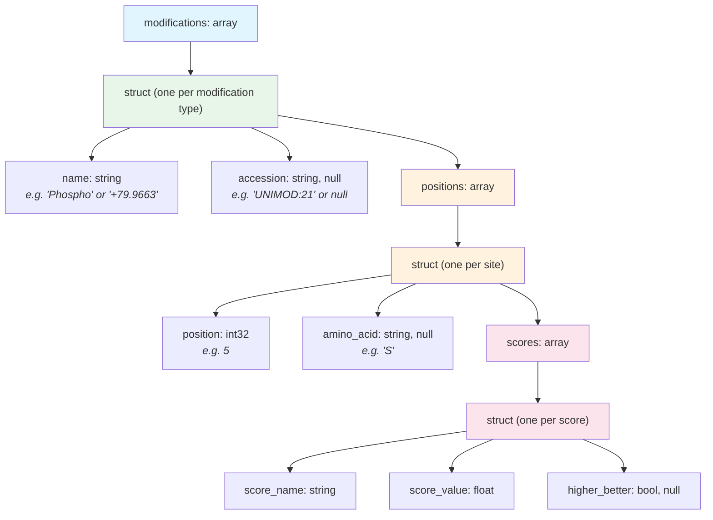

# Modifications

Modifications are chemical changes to a peptide sequence -- phosphorylation, oxidation, isobaric labels, and many others. In QPX, modifications are represented in two complementary ways:

1. **Inline** in the [peptidoform](peptidoform.md) string using ProForma notation
2. **Structured** in the `modifications` field as an array of nested records with position details and localization scores

The inline representation is compact and human-readable. The structured representation enables programmatic queries such as "find all phosphorylations with localization probability above 0.75."

## Inline representation

Modifications are written inside square brackets in the peptidoform string, immediately after the residue they modify.

```text
PEPT[Phospho]IDM[Oxidation]K
```

Conventions for inline modification names:

| Convention | Example | When to use |
| ---------- | ------- | ----------- |
| UNIMOD accession (recommended) | `PEPT[UNIMOD:21]IDM[UNIMOD:35]K` | Always preferred -- accessions are unambiguous |
| Common name | `PEPT[Phospho]IDM[Oxidation]K` | Acceptable when UNIMOD accession exists |
| Mass shift (unknown PTMs) | `PEPT[+79.9663]IDK` | For modifications without a UNIMOD entry; value in Daltons with sign |

!!! tip
    Always prefer UNIMOD accessions over common names. Names can be ambiguous across tools, but accessions are globally unique.

!!! note "Unknown modifications"
    When a modification cannot be mapped to a UNIMOD or other ontology entry, the ProForma notation uses the mass delta with sign directly (e.g., `[+79.9663]` or `[-17.027]`). In the structured representation, the `name` field carries the mass with sign (e.g., `"+79.9663"`) and the `accession` field is `null`.

## Structured representation

The `modifications` field is an `array[struct]` where each element describes one modification type applied to the peptide. The nested structure captures the modification identity, the positions where it occurs, and any associated localization scores.



### Struct definition

```text
modifications: array[struct{
    name:      string,          -- Human-readable name (e.g. "Phospho") or mass with sign (e.g. "+79.9663")
    accession: string, null,    -- Ontology accession (e.g. "UNIMOD:21"); null for unknown modifications
    positions: array[struct{
        position:   int32,      -- Numeric position in the peptide (see position format below)
        amino_acid: string, null, -- Single-letter amino acid code; null for terminal modifications
        scores:     array[struct{
            score_name:    string,     -- Score identifier (e.g. "localization_probability")
            score_value:   float,      -- Numeric score value
            higher_better: bool, null  -- Score direction; null if unknown
        }]
    }]
}]
```

## Position format rules

Each modification site is described by two fields:

- **`position`** (`int32`) -- The numeric position in the peptide sequence
- **`amino_acid`** (`string`, nullable) -- The single-letter amino acid code at that position, or `null` for terminal modifications

| Position type | `position` | `amino_acid` | Meaning |
| ------------- | ---------- | ------------ | ------- |
| Amino acid residue | 1-based index (e.g. `5`) | Single-letter code (e.g. `"S"`) | Serine at position 5 |
| N-terminal | `0` | `null` | Modification on the peptide N-terminus |
| C-terminal | `length + 1` (e.g. `9`) | `null` | Modification on the C-terminus of an 8-residue peptide |

!!! warning
    Positions are **1-based** for amino acid residues. The N-terminal position is always `0`, and the C-terminal position is always `length + 1`, where `length` is the number of amino acids in the bare sequence.

!!! note "Relationship to searched modifications"
    The `modifications` struct described here is for **per-PSM/feature reporting** -- it records which modifications were actually observed in a specific peptide identification, with localization scores. For the list of modifications configured in the search engine, see the `modification_parameters` field in [run.parquet](run.md), which uses the [MODIFICATION](run.md#modification-structure) structure.

## Localization scores

Each position can carry one or more scores that describe the confidence in placing the modification at that particular site. The most common score is `localization_probability`, which ranges from 0.0 to 1.0.

- **localization_probability**: The probability that this modification is correctly assigned to this specific residue. A value of 0.99 means 99% confidence.
- **higher_better**: Indicates score direction. For localization probability, this is `true` (higher is better).

Multiple scores can be attached to a single position -- for example, both a localization probability and a tool-specific confidence metric.

## Competing interpretations

The `modifications` field records what the peptidoform says: which modification sits where. A spectrum often fits other readings as well, and those are lost there:

- **Localization**: the same modification on another residue (a phosphate on S4 or T5).
- **Identity**: another modification at the same residue. Near-isobaric modifications such as acetyl (+42.0106 Da) and trimethyl (+42.0470 Da) are often not told apart.
- **Substitution**: a residue change with the same mass as a modification. D→E and G→A weigh the same as methylation (+14.0157 Da), and N→D the same as deamidation.

The optional `modification_candidates` column of the PSM and feature views lists every interpretation the producer considered, position by position. A position can hold several candidates, and a modification can have several candidate positions. Candidates that are mutually exclusive explanations of one event share an `alternative_group`; candidates that can co-occur (a SILAC label and an acetyl on one lysine) are in different groups or in none.

```text
modification_candidates: array[struct{
    position:    int32,          -- same convention as modifications (0 N-term, length + 1 C-term)
    amino_acid:  string, null,   -- residue at the position; null for a terminus
    name:        string,         -- modification name, or a substitution ("Asp->Glu")
    accession:   string, null,   -- e.g. "UNIMOD:1"; substitutions use Unimod's amino-acid substitution entries
    mass_delta:  float64, null,  -- monoisotopic mass shift (Da)
    probability: float64, null,  -- P(this modification at this position | this identification)
    assigned:    bool,           -- true where the peptidoform places it
    alternative_group: int32, null,  -- candidates with the same group exclude each other
    scores:      array[score], null  -- tool scores for this candidate
}]
```

Example: `PEPS[Phospho]TK[Label:13C(6)15N(2)][Acetyl]R` from a SILAC heavy channel, where the phosphate could also be on T5 and the +42 Da on K6 could be trimethyl. The heavy label on K6 is certain and co-occurs with the +42 Da, so it is in no group:

```json
[
  {"position": 4, "amino_acid": "S", "name": "Phospho",   "accession": "UNIMOD:21",  "probability": 0.95, "assigned": true,  "alternative_group": 1},
  {"position": 5, "amino_acid": "T", "name": "Phospho",   "accession": "UNIMOD:21",  "probability": 0.05, "assigned": false, "alternative_group": 1},
  {"position": 6, "amino_acid": "K", "name": "Acetyl",    "accession": "UNIMOD:1",   "probability": 0.71, "assigned": true,  "alternative_group": 2},
  {"position": 6, "amino_acid": "K", "name": "Trimethyl", "accession": "UNIMOD:37",  "probability": 0.29, "assigned": false, "alternative_group": 2},
  {"position": 6, "amino_acid": "K", "name": "Label:13C(6)15N(2)", "accession": "UNIMOD:259", "probability": 1.0, "assigned": true, "alternative_group": null}
]
```

(`mass_delta` and `scores` are left out of the example for space.)

The probabilities are marginals of one posterior over the peptide's interpretations:

- An **alternative group** is one modification event and its mutually exclusive explanations, so its probabilities sum to at most 1. Group 1 is localization (one phosphate, on S4 or T5); group 2 is identity (acetyl or trimethyl on K6). A group can mix both, e.g. one +42 Da on K6 or K9, as acetyl or trimethyl.
- Probabilities are not summed across groups or over ungrouped candidates: modifications in different groups can occur together, so the sum over all candidates at a position is not the probability that the position is modified.
- `assigned` rows agree with `modifications` and the peptidoform; the others are alternatives they cannot hold.
- `alternative_group` ids are scoped to one row: group 1 of one PSM has nothing to do with group 1 of another.

In the PSM view the probabilities are given this one identification. In the feature view they are combined over the feature's identifications. The recommended rule is a mixture: the probability of a candidate is the average of its probabilities in the feature's PSMs, weighted by the confidence of each identification (1 − PEP where PEP is available, equal weights otherwise). A mixture of marginals is a marginal, so the sums within an alternative group stay at most 1; summing over PSMs does not. A producer that combines differently (best PSM, maximum) records its rule in [provenance](provenance.md), so the psm → feature → [site](site.md) chain can be reproduced. The site view combines the feature values at the protein level. A substitution that spans more than one residue cannot be a candidate at one position; it is a [sequence edit](sequence-edits.md).

!!! note "Validation"
    Under `qpxc validate` (strict), candidate probabilities are finite and in [0, 1], and those of one alternative group sum to at most 1. A candidate field of the wrong type is reported as a type mismatch and the probability checks are skipped.

### Substitution candidates

A substitution competes with a modification of the same mass at one position (D→E and methyl on D, +14.0157 Da). The conventions:

- `position` and `amino_acid` are in the coordinates of the **observed** peptide sequence, like every other candidate; a [sequence edit](sequence-edits.md) is in the reference protein's coordinates. For `Asp->Glu` at position 4 the `amino_acid` is `E`, the residue that was observed.
- The target residue of a modification candidate is implied by its Unimod entry, not by `amino_acid`. When methylation of D competes with D→E at position 4, both candidates are at position 4 and the observed residue is `E`; the methylation candidate says that the residue would be a methylated D, not that E is methylated. Readers must not take `amino_acid` as the modification site residue for a candidate that competes with a substitution.
- `name` and `accession` are the Unimod amino-acid substitution entry (`Asp->Glu`), and `mass_delta` is observed minus reference (`Asp->Glu` = +14.0157).
- `assigned` is true when the peptidoform's sequence is the substituted one, so the observed residue is the substituted residue. A peptidoform cannot place a substitution as it does a modification, so a producer that reports the unsubstituted reading (the reference residue with a modification) sets `assigned` false on the substitution candidate and true on the modification.

## Complete example

Consider the peptide `PEPTSDMK` with a phosphorylation on Ser at position 5 (high confidence) and an oxidation on Met at position 7.

**Peptidoform string:**

```text
PEPTS[Phospho]DM[Oxidation]K
```

**Structured `modifications` field (JSON):**

```json
[
  {
    "name": "Phospho",
    "accession": "UNIMOD:21",
    "positions": [
      {
        "position": 5,
        "amino_acid": "S",
        "scores": [
          {
            "score_name": "localization_probability",
            "score_value": 0.97,
            "higher_better": true
          }
        ]
      }
    ]
  },
  {
    "name": "Oxidation",
    "accession": "UNIMOD:35",
    "positions": [
      {
        "position": 7,
        "amino_acid": "M",
        "scores": [
          {
            "score_name": "localization_probability",
            "score_value": 0.99,
            "higher_better": true
          }
        ]
      }
    ]
  }
]
```

### N-terminal modification example

An N-terminal acetylation on the peptide `VLHPLEGAVVIIFK`:

```json
{
  "name": "Acetyl",
  "accession": "UNIMOD:1",
  "positions": [
    {
      "position": 0,
      "amino_acid": null,
      "scores": null
    }
  ]
}
```

### Unknown modification example

A mass shift of +42.011 Da on Lys at position 3, where no UNIMOD accession is known. The peptidoform would be `PEK[+42.011]TIDE`:

```json
{
  "name": "+42.011",
  "accession": null,
  "positions": [
    {
      "position": 3,
      "amino_acid": "K",
      "scores": null
    }
  ]
}
```

!!! note
    The `modifications` field is nullable at the record level. If a peptide has no modifications, the field value is `null` rather than an empty array.

## Where modifications are used

The `modifications` field is available in the following QPX views:

| View                     | Field name       | Notes                                               |
| ------------------------ | ---------------- | --------------------------------------------------- |
| PSM (`psm_file`)         | `modifications`  | Per-PSM modification detail with localization scores |
| Feature (`feature_file`) | `modifications`  | Carried forward from best PSM or identification      |
| PSM, Feature             | `modification_candidates` | Competing interpretations per position, with probabilities (optional) |
| Peptide (`peptide_file`) | `modifications`  | Summarized at the peptide level                      |

## Further reading

- [Peptidoform](peptidoform.md) -- the inline ProForma representation
- [Scores & CV Terms](scores.md) -- how scores are structured across QPX
- [QPX Format Overview](index.md) -- full list of views and concepts
